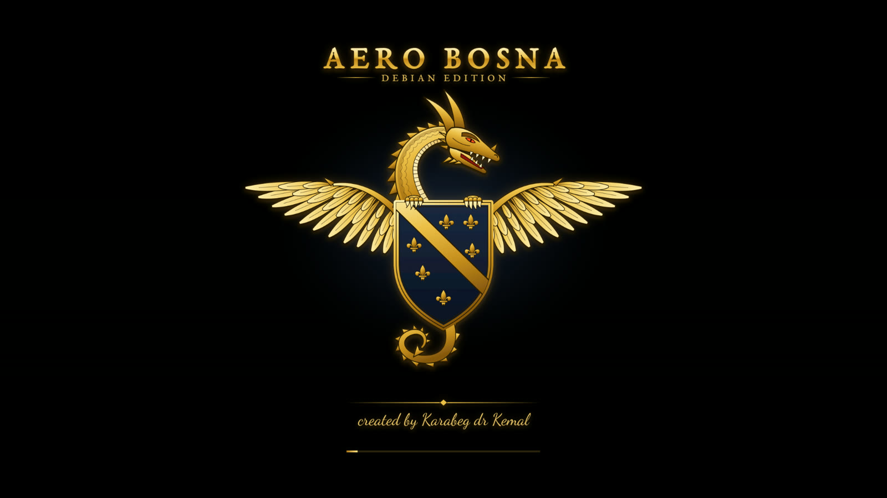
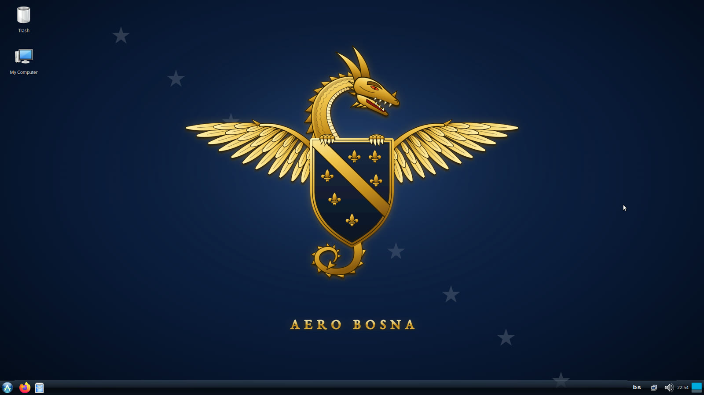
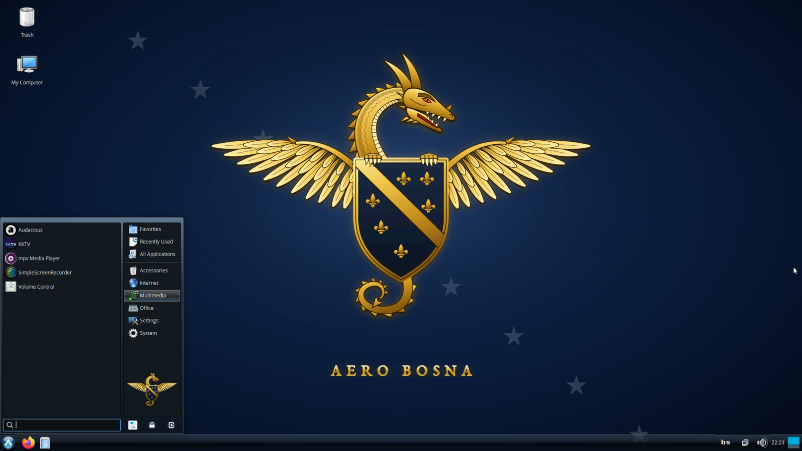

# Aero Bosna

**[⬇ Download Aero Bosna (ISO)](https://github.com/m3mmo81/aero-bosna-apt/releases/latest)**

**[English](#english) · [Bosanski](#bosanski)**

## Screenshots · Slike

| | |
|---|---|
|  |  |
| **Boot menu** | **Boot splash** |
|  |  |
| **Desktop** | **Start menu** |

**▶ Video:** https://youtu.be/wOGgYgMewTw

## English
A lightweight Debian 13 "Trixie" desktop with a dark, Vista-inspired look and a golden dragon emblem.
Made for older computers, runs on new ones too (UEFI, Secure Boot). *created by Karabeg dr Kemal*

**Download:** the ISO is on the [Releases page](https://github.com/m3mmo81/aero-bosna-apt/releases/latest),
together with instructions for writing it to a USB stick and installing.

This repository is also the signed APT repository with Aero Bosna updates
(theme, Welcome app, settings, KKTV). Installed systems receive them with `sudo apt update && sudo apt upgrade`.
To add it to an existing Aero Bosna system:
```sh
sudo apt install wget
wget https://m3mmo81.github.io/aero-bosna-apt/aero-bosna-apt.deb
sudo apt install ./aero-bosna-apt.deb
sudo apt update && sudo apt install aero-bosna-desktop
```

## Bosanski
Lagani Debian 13 "Trixie" desktop s tamnim izgledom inspirisanim Vistom i zlatnim zmajem.
Pravljen za starije računare, radi i na novim (UEFI, Secure Boot). *created by Karabeg dr Kemal*

**Preuzimanje:** ISO je na [stranici izdanja](https://github.com/m3mmo81/aero-bosna-apt/releases/latest),
zajedno s uputstvom za upis na USB stick i instalaciju.

Ovaj repozitorij je i potpisani APT repozitorij s ažuriranjima Aero Bosne
(tema, Welcome, postavke, KKTV). Instalirani sistemi ih dobijaju sa `sudo apt update && sudo apt upgrade`.
Dodavanje na postojeći Aero Bosna sistem:
```sh
sudo apt install wget
wget https://m3mmo81.github.io/aero-bosna-apt/aero-bosna-apt.deb
sudo apt install ./aero-bosna-apt.deb
sudo apt update && sudo apt install aero-bosna-desktop
```

Code GPL-3.0-or-later, artwork CC-BY-SA 4.0, KKTV © Karabeg dr Kemal.
