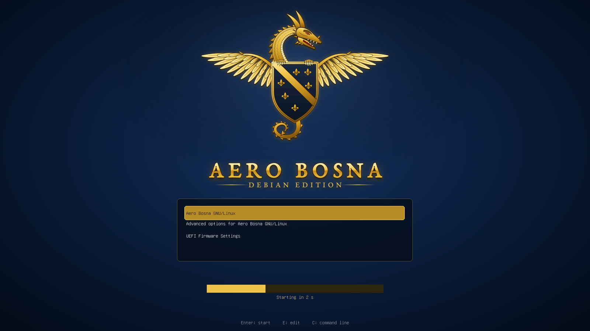

# Aero Bosna

**[⬇ Download Aero Bosna (ISO)](https://github.com/m3mmo81/aero-bosna-apt/releases/latest)**

> 🆕 **KKTV 1.5.7 is out / KKTV 1.5.7 je izašao** (23.11.2026): default PIN is now **0000** / zadani PIN je sada **0000**.
> [What's new](#app-updates) · [Šta je novo](#ažuriranja-aplikacija) · update: `sudo apt update && sudo apt upgrade`

**[English](#english) · [Bosanski](#bosanski) · [App updates](#app-updates) · [Ažuriranja](#ažuriranja-aplikacija)**

## Screenshots · Slike

| | |
|---|---|
|  |  |
| **Boot menu** | **Boot splash** |
|  |  |
| **Desktop** | **Start menu** |

**▶ Video:** https://youtu.be/wOGgYgMewTw

## English
A lightweight Debian 13 "Trixie" desktop with a dark, Vista-inspired look and a golden dragon emblem.
Made for older computers, runs on new ones too (UEFI, Secure Boot). *created by Karabeg dr Kemal*

**Download:** the ISO is on the [Releases page](https://github.com/m3mmo81/aero-bosna-apt/releases/latest),
together with instructions for writing it to a USB stick and installing.

This repository is also the signed APT repository with Aero Bosna updates
(theme, Welcome app, settings, KKTV). Installed systems receive them with `sudo apt update && sudo apt upgrade`.
To add it to an existing Aero Bosna system:
```sh
sudo apt install wget
wget https://m3mmo81.github.io/aero-bosna-apt/aero-bosna-apt.deb
sudo apt install ./aero-bosna-apt.deb
sudo apt update && sudo apt install aero-bosna-desktop
```

**Note for older Chromebooks:** Intel Chromebooks from about 2016–2018 (Skylake, Kaby Lake, Apollo Lake) with the
max98357a speaker amplifier need the AVS sound driver, which Aero Bosna does not enable, so their speakers may stay silent.
Do not enable it yourself (for example with the `--force-avs-install` option of the chromebook-linux-audio script):
Linux does not have the speaker protection that ChromeOS has, and loud volume can permanently damage the speakers.
Headphones and HDMI audio are safe.

## App updates
**KKTV 1.5.7** (2026-11-23), arrives with `sudo apt update && sudo apt upgrade`:
- **The default PIN is now 0000** (it was 3011). Change it in **Settings → Parental control**. Until you do, the PIN screen shows the default PIN and Settings reminds you to change it.
- After 5 wrong PINs in a row there is a 30-second pause.
- Everything without a known category is now in one category, **Other**.
- Movie or series info without an active playlist now shows an error instead of freezing.

## Bosanski
Lagani Debian 13 "Trixie" desktop s tamnim izgledom inspirisanim Vistom i zlatnim zmajem.
Pravljen za starije računare, radi i na novim (UEFI, Secure Boot). *created by Karabeg dr Kemal*

**Preuzimanje:** ISO je na [stranici izdanja](https://github.com/m3mmo81/aero-bosna-apt/releases/latest),
zajedno s uputstvom za upis na USB stick i instalaciju.

Ovaj repozitorij je i potpisani APT repozitorij s ažuriranjima Aero Bosne
(tema, Welcome, postavke, KKTV). Instalirani sistemi ih dobijaju sa `sudo apt update && sudo apt upgrade`.
Dodavanje na postojeći Aero Bosna sistem:
```sh
sudo apt install wget
wget https://m3mmo81.github.io/aero-bosna-apt/aero-bosna-apt.deb
sudo apt install ./aero-bosna-apt.deb
sudo apt update && sudo apt install aero-bosna-desktop
```

**Napomena za starije Chromebookove:** Intel Chromebookovi od otprilike 2016. do 2018. (Skylake, Kaby Lake, Apollo Lake)
s pojačalom za zvučnike max98357a trebaju AVS drajver za zvuk, koji Aero Bosna ne uključuje, pa zvučnici mogu ostati nijemi.
Ne uključujte ga sami (npr. opcijom `--force-avs-install` skripte chromebook-linux-audio): Linux nema zaštitu
zvučnika kakvu ima ChromeOS, pa jak zvuk može trajno oštetiti zvučnike. Slušalice i HDMI zvuk su sigurni.

## Ažuriranja aplikacija
**KKTV 1.5.7** (23.11.2026), stiže sa `sudo apt update && sudo apt upgrade`:
- **Zadani PIN je sada 0000** (bio je 3011). Promijenite ga u **Postavke → Roditeljska zaštita**. Dok ga ne promijenite, ekran za PIN pokazuje zadani PIN, a Postavke podsjećaju da ga promijenite.
- Nakon 5 pogrešnih PIN-ova zaredom slijedi pauza od 30 sekundi.
- Sve što nema poznatu kategoriju sada je u jednoj kategoriji **Ostalo**.
- Info filma ili serije bez aktivne playliste sada pokaže grešku, umjesto da aplikacija zablokira.

Code GPL-3.0-or-later, artwork CC-BY-SA 4.0, KKTV © Karabeg dr Kemal.
